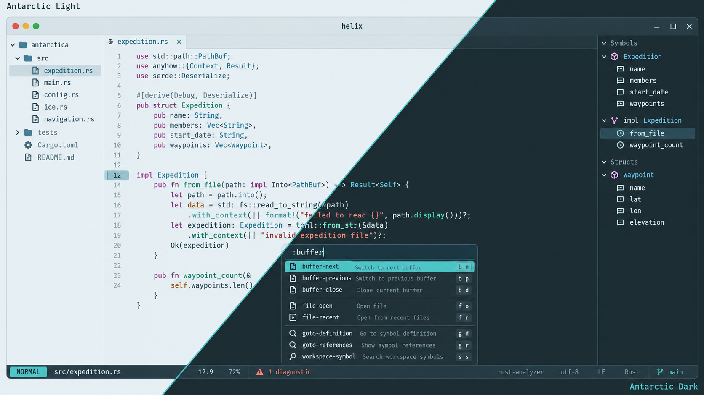

# Antarctic for Helix

Light and dark themes based on the shared [Antarctic palette](https://github.com/AntarcticTheme/.github/blob/main/profile/README.md).



## Requirements

Install [Helix](https://docs.helix-editor.com/install.html). 

Use a true-color terminal. 

The theme consists of two TOML files.

## Install

Make sure you have the folder `"$HOME/.config/helix/themes"` already created.

Download both theme files:

```sh
curl -fL https://raw.githubusercontent.com/AntarcticTheme/Helix/main/themes/antarctic_light.toml -o "$HOME/.config/helix/themes/antarctic_light.toml"
curl -fL https://raw.githubusercontent.com/AntarcticTheme/Helix/main/themes/antarctic_dark.toml -o "$HOME/.config/helix/themes/antarctic_dark.toml"
```

On Windows, create the destination directory if necessary, then download the same files using the GitHub raw-file download button and copy them into `%APPDATA%\helix\themes`.

Set this at the top level of `~/.config/helix/config.toml` (before any table headings):

```toml
theme = "antarctic_dark"
```

Use `antarctic_light` for light mode. 

Switch immediately using `:theme antarctic_light` or `:theme antarctic_dark`.

Includes syntax, diagnostics, diffs, selections, completion, popups, status and buffer lines, and inlay hints.

## Updates

To update, repeat the download/copy steps, then restart the application or reload its configuration.

Released under the MIT license. See [LICENSE](LICENSE).
